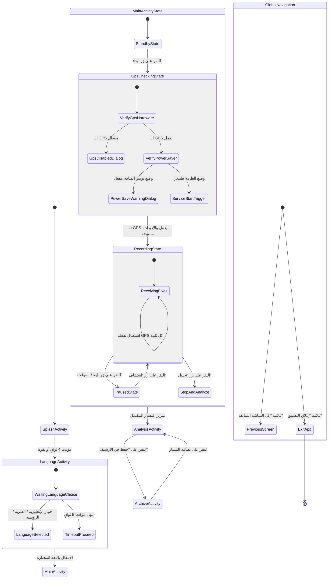

# 🧩 مخطط الحالات والتنقل وخريطة الفئات — معامل التعرج

دليل الطلاب والمطورين المبتدئين: فهم حالات المستخدم، وتدفق التنقل، وهندسة النظام.

---

## 1. المخطط 1: التنقل والحالات (Mermaid stateDiagram-v2)



---

## 2. المخطط 2: خريطة الفئات والعلاقات (Mermaid flowchart TD)

```mermaid
flowchart TD
  classDef activity fill:#DBEAFE,stroke:#1E40AF,stroke-width:3px
  classDef service fill:#E0E7FF,stroke:#3730A3,stroke-width:3px
  classDef dialog fill:#EDE9FE,stroke:#6D28D9,stroke-width:2px
  classDef model fill:#FEF9C3,stroke:#A16207,stroke-width:2px
  classDef data fill:#FCE7F3,stroke:#BE185D,stroke-width:2px
  classDef adapter fill:#FFEDD5,stroke:#C2410C,stroke-width:2px
  classDef helper fill:#F3F4F6,stroke:#6B7280,stroke-width:2px,stroke-dasharray:5 5
  classDef system fill:#E5E7EB,stroke:#9CA3AF,stroke-width:1px,stroke-dasharray:3 3

  subgraph UI["طبقة: الشاشات والعروض"]
    SplashActivity["SplashActivity<br/>[Activity]"]
    LanguageActivity["LanguageActivity<br/>[Activity]"]
    MainActivity["MainActivity<br/>[Activity]"]
    AnalysisActivity["AnalysisActivity<br/>[Activity]"]
    ArchiveActivity["ArchiveActivity<br/>[Activity]"]
    TrackCanvasView["TrackCanvasView<br/>[View]"]
  end

  subgraph SERVICE["طبقة: خدمة الخلفية"]
    TrackRecordingService["TrackRecordingService<br/>[Service]"]
  end

  subgraph MODEL["طبقة: النماذج"]
    Track["Track<br/>[Model]"]
    TrackPoint["TrackPoint<br/>[Model]"]
  end

  subgraph DATA["طبقة: التخزين"]
    TrackStorage[("TrackStorage<br/>[Data]")]
  end

  subgraph HELPERS["طبقة: الأدوات والمحولات"]
    LocaleHelper[["LocaleHelper<br/>[Helper]"]]
    GpsCheckUtils[["GpsCheckUtils<br/>[Helper]"]]
    TrackAdapter[/"TrackAdapter<br/>[Adapter]"/]
  end

  subgraph LEGEND["دليل الرموز"]
    L_Act["Activity<br/>[Activity]"]
    L_Svc["Service<br/>[Service]"]
    L_Mod["Model<br/>[Model]"]
    L_Dat[("Data<br/>[Data]")]
    L_Hlp[["Helper<br/>[Helper]"]]
    L_Adp[/"Adapter<br/>[Adapter]"/]
  end

  SplashActivity -->|مؤقت 4 ثوانٍ| LanguageActivity
  LanguageActivity -->|مؤقت 5 ثوانٍ أو اختيار| MainActivity
  MainActivity -->|تشغيل / ربط| TrackRecordingService
  MainActivity -.->|يستخدم القماش| TrackCanvasView
  MainActivity -->|يمرر المسار| AnalysisActivity
  AnalysisActivity -.->|يستخدم القماش| TrackCanvasView
  AnalysisActivity ==>|يحفظ المسار| TrackStorage
  ArchiveActivity ==>|يقرأ/يحذف| TrackStorage
  ArchiveActivity -.->|يستخدم القائمة| TrackAdapter
  TrackRecordingService ==>|يحدث النقاط| Track
  Track *-- TrackPoint
  LanguageActivity -.->|يطبق اللغة| LocaleHelper
  MainActivity -.->|يفحص الـ GPS| GpsCheckUtils

  class SplashActivity,LanguageActivity,MainActivity,AnalysisActivity,ArchiveActivity,L_Act activity
  class TrackRecordingService,L_Svc service
  class TrackCanvasView activity
  class Track,TrackPoint,L_Mod model
  class TrackStorage,L_Dat data
  class LocaleHelper,GpsCheckUtils,L_Hlp helper
  class TrackAdapter,L_Adp adapter
```

---

## 3. أسئلة للاختبار الذاتي

1. **سؤال:** ما هي مدة المؤقت التنازلي في شاشة اختيار اللغة `LanguageActivity`؟
   - *الجواب:* 5 ثوانٍ (5000 ميلي ثانية).
2. **سؤال:** ما هي الحالة التي ينتقل إليها التطبيق عند النقر على "إيقاف مؤقت" أثناء التسجيل؟
   - *الجواب:* حالة `PausedState`.
3. **سؤال:** ما نوع السهم الذي يربط بين `AnalysisActivity` و `TrackStorage`؟
   - *الجواب:* سهم سميك `==>` يمثل تمرير البيانات للحفظ في ملف JSON.
