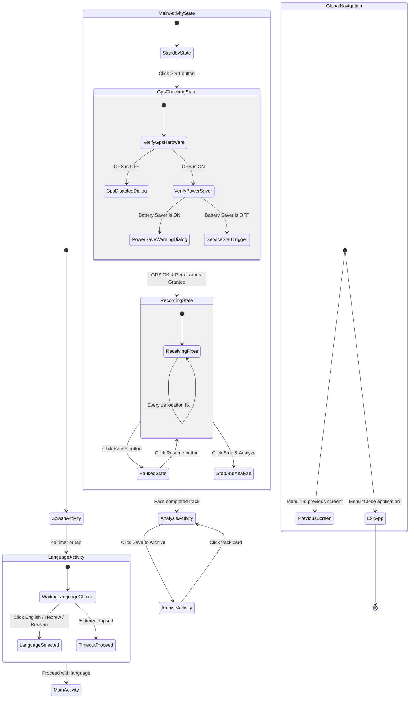

# 🧩 State & Navigation Diagram and Class Map Guide — Tortuosity Coefficient

High-School Developer Guide: Understanding User States, Navigation Flows, and System Architecture.

---

## 1. Diagram 1: Navigation and User States (Mermaid stateDiagram-v2)



### Reading Diagram 1

| Element | Meaning |
| :--- | :--- |
| `[*]` | Start or Exit point of application lifecycle. |
| **State Box** | Screen or internal app state user is currently seeing. |
| **Composite State** | Screen containing multiple sub-states (e.g. `MainActivityState`). |
| **Transition Arrow** | User action, timer event, or condition triggering state change. |

---

## 2. Diagram 2: Class & Relationship Map (Mermaid flowchart TD)

```mermaid
flowchart TD
  classDef activity fill:#DBEAFE,stroke:#1E40AF,stroke-width:3px
  classDef service fill:#E0E7FF,stroke:#3730A3,stroke-width:3px
  classDef dialog fill:#EDE9FE,stroke:#6D28D9,stroke-width:2px
  classDef model fill:#FEF9C3,stroke:#A16207,stroke-width:2px
  classDef data fill:#FCE7F3,stroke:#BE185D,stroke-width:2px
  classDef adapter fill:#FFEDD5,stroke:#C2410C,stroke-width:2px
  classDef helper fill:#F3F4F6,stroke:#6B7280,stroke-width:2px,stroke-dasharray:5 5
  classDef system fill:#E5E7EB,stroke:#9CA3AF,stroke-width:1px,stroke-dasharray:3 3

  subgraph UI["Layer: Screens & Views"]
    SplashActivity["SplashActivity<br/>[Activity]"]
    LanguageActivity["LanguageActivity<br/>[Activity]"]
    MainActivity["MainActivity<br/>[Activity]"]
    AnalysisActivity["AnalysisActivity<br/>[Activity]"]
    ArchiveActivity["ArchiveActivity<br/>[Activity]"]
    TrackCanvasView["TrackCanvasView<br/>[View]"]
  end

  subgraph SERVICE["Layer: Background Service"]
    TrackRecordingService["TrackRecordingService<br/>[Service]"]
  end

  subgraph MODEL["Layer: Models"]
    Track["Track<br/>[Model]"]
    TrackPoint["TrackPoint<br/>[Model]"]
  end

  subgraph DATA["Layer: Storage"]
    TrackStorage[("TrackStorage<br/>[Data]")]
  end

  subgraph HELPERS["Layer: Utilities & Adapters"]
    LocaleHelper[["LocaleHelper<br/>[Helper]"]]
    GpsCheckUtils[["GpsCheckUtils<br/>[Helper]"]]
    TrackAdapter[/"TrackAdapter<br/>[Adapter]"/]
  end

  subgraph LEGEND["Legend"]
    L_Act["Activity<br/>[Activity]"]
    L_Svc["Service<br/>[Service]"]
    L_Mod["Model<br/>[Model]"]
    L_Dat[("Data<br/>[Data]")]
    L_Hlp[["Helper<br/>[Helper]"]]
    L_Adp[/"Adapter<br/>[Adapter]"/]
  end

  SplashActivity -->|4s timer| LanguageActivity
  LanguageActivity -->|5s timer or click| MainActivity
  MainActivity -->|Start / Bind| TrackRecordingService
  MainActivity -.->|Uses canvas| TrackCanvasView
  MainActivity -->|Passes track| AnalysisActivity
  AnalysisActivity -.->|Uses canvas| TrackCanvasView
  AnalysisActivity ==>|save track| TrackStorage
  ArchiveActivity ==>|load/delete| TrackStorage
  ArchiveActivity -.->|Uses list| TrackAdapter
  TrackRecordingService ==>|updates points| Track
  Track *-- TrackPoint
  LanguageActivity -.->|Applies locale| LocaleHelper
  MainActivity -.->|Checks GPS| GpsCheckUtils

  class SplashActivity,LanguageActivity,MainActivity,AnalysisActivity,ArchiveActivity,L_Act activity
  class TrackRecordingService,L_Svc service
  class TrackCanvasView activity
  class Track,TrackPoint,L_Mod model
  class TrackStorage,L_Dat data
  class LocaleHelper,GpsCheckUtils,L_Hlp helper
  class TrackAdapter,L_Adp adapter
```

### Reading Diagram 2

| Node Type | Shape & Color | Description & Project Example |
| :--- | :--- | :--- |
| **Activity** | Blue Rectangle `[ ]` | UI Screen window (`MainActivity`, `SplashActivity`). |
| **Service** | Indigo Thick Rectangle `[ ]` | Background execution service (`TrackRecordingService`). |
| **Model** | Yellow Rectangle `[ ]` | Pure data object (`Track`, `TrackPoint`). |
| **Data** | Pink Cylinder `[( )]` | File/DB Storage layer (`TrackStorage`). |
| **Adapter** | Orange Parallelogram `[/ /]` | RecyclerView list adapter (`TrackAdapter`). |
| **Helper** | Gray Subroutine `[[ ]]` | Utility class (`LocaleHelper`, `GpsCheckUtils`). |

---

## 3. Simple Words Explanation

### 1. Main Idea & Everyday Analogy
At any given millisecond, the application is in **exactly one active state**. Events (user clicks, GPS fixes, timer completions) trigger transitions from one state to another.

**Everyday Analogy: Subway Metro Turnstile**
- **State 1 (Locked):** Waiting for passenger card.
- **Event (Card tapped):** Validates payment.
- **State 2 (Unlocked):** Barrier opens.
- **Event (Passenger walks through):** Locks barrier back to State 1.

### 2. App Launch Sequence
`SplashActivity` (4s timer) ──> `LanguageActivity` (5s timer) ──> `MainActivity` (`StandbyState`).

### 3. Dashboard Internal States
`StandbyState` ──[Click Start]──> `GpsCheckingState` ──[GPS OK]──> `RecordingState` ──[Click Pause]──> `PausedState`.

---

## 4. Code Examples

### Transition Code Example (Java Intent)
```java
Intent intent = new Intent(SplashActivity.this, LanguageActivity.class);
startActivity(intent);
finish();
```

### Data Storage Code Example (JSON)
```java
boolean saved = storage.addTrack(track);
if (saved) {
    Intent intent = new Intent(this, ArchiveActivity.class);
    startActivity(intent);
}
```

---

## 5. Self-Test Questions

1. **Q:** What is the duration of the countdown timer on `LanguageActivity`?
   - *A:* 5 seconds (5000 ms).
2. **Q:** Which state is entered when the user taps "Pause" during recording?
   - *A:* `PausedState`.
3. **Q:** What type of arrow connects `AnalysisActivity` to `TrackStorage`?
   - *A:* Thick arrow `==>` denoting data persistence (saving track to JSON).
