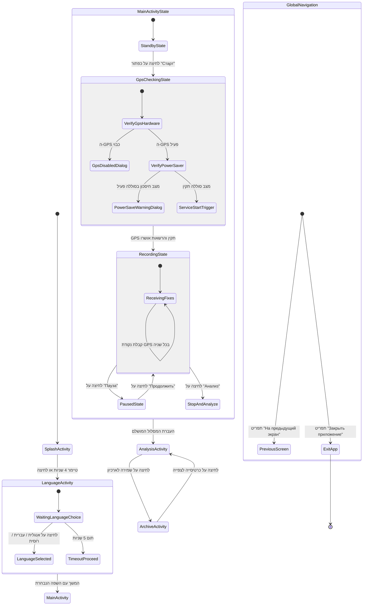

# 🧩 דיאגרמת ניווט ומצבים ומפת מחלקות — מקדם פתלתלות

מדריך מודרך לתלמידי תיכון: הבנת מצבי משתמש, מעברי ניווט ואנליזת ארכיטקטורה.

---

## 1. דיאגרמה 1: ניווט ומצבים (Mermaid stateDiagram-v2)



### איך לקרוא את דיאגרמה 1

| אלמנט | משמעות |
| :--- | :--- |
| `[*]` | נקודת ההתחלה או היציאה של האפליקציה. |
| **מלבן מצב (State)** | המסך או המצב הפנימי שהמשתמש רואה כעת. |
| **מצב מורכב (Composite)** | מסך המכיל מצבים פנימיים (כמו `MainActivityState`). |
| **חץ מעבר (Transition)** | אירוע, לחיצת כפתור או תנאי המעביר ממצב אחד לאחר. |

---

## 2. דיאגרמה 2: מפת מחלקות וקשרים (Mermaid flowchart TD)

```mermaid
flowchart TD
  classDef activity fill:#DBEAFE,stroke:#1E40AF,stroke-width:3px
  classDef service fill:#E0E7FF,stroke:#3730A3,stroke-width:3px
  classDef dialog fill:#EDE9FE,stroke:#6D28D9,stroke-width:2px
  classDef model fill:#FEF9C3,stroke:#A16207,stroke-width:2px
  classDef data fill:#FCE7F3,stroke:#BE185D,stroke-width:2px
  classDef adapter fill:#FFEDD5,stroke:#C2410C,stroke-width:2px
  classDef helper fill:#F3F4F6,stroke:#6B7280,stroke-width:2px,stroke-dasharray:5 5
  classDef system fill:#E5E7EB,stroke:#9CA3AF,stroke-width:1px,stroke-dasharray:3 3

  subgraph UI["שכבה: מסכים ותצוגה"]
    SplashActivity["SplashActivity<br/>[Activity]"]
    LanguageActivity["LanguageActivity<br/>[Activity]"]
    MainActivity["MainActivity<br/>[Activity]"]
    AnalysisActivity["AnalysisActivity<br/>[Activity]"]
    ArchiveActivity["ArchiveActivity<br/>[Activity]"]
    TrackCanvasView["TrackCanvasView<br/>[View]"]
  end

  subgraph SERVICE["שכבה: שירותי רקע"]
    TrackRecordingService["TrackRecordingService<br/>[Service]"]
  end

  subgraph MODEL["שכבה: מודלים"]
    Track["Track<br/>[Model]"]
    TrackPoint["TrackPoint<br/>[Model]"]
  end

  subgraph DATA["שכבה: נתונים"]
    TrackStorage[("TrackStorage<br/>[Data]")]
  end

  subgraph HELPERS["שכבה: מסייעים ומתאמים"]
    LocaleHelper[["LocaleHelper<br/>[Helper]"]]
    GpsCheckUtils[["GpsCheckUtils<br/>[Helper]"]]
    TrackAdapter[/"TrackAdapter<br/>[Adapter]"/]
  end

  subgraph LEGEND["מקרא"]
    L_Act["Activity<br/>[Activity]"]
    L_Svc["Service<br/>[Service]"]
    L_Mod["Model<br/>[Model]"]
    L_Dat[("Data<br/>[Data]")]
    L_Hlp[["Helper<br/>[Helper]"]]
    L_Adp[/"Adapter<br/>[Adapter]"/]
  end

  SplashActivity -->|טיימר 4 שנ'| LanguageActivity
  LanguageActivity -->|טיימר 5 שנ' או בחירה| MainActivity
  MainActivity -->|הפעלה / Bind| TrackRecordingService
  MainActivity -.->|משתמש בקנבס| TrackCanvasView
  MainActivity -->|מעביר מסלול| AnalysisActivity
  AnalysisActivity -.->|משתמש בקנבס| TrackCanvasView
  AnalysisActivity ==>|שומר מסלול| TrackStorage
  ArchiveActivity ==>|טוען/מוחק| TrackStorage
  ArchiveActivity -.->|משתמש ברשימה| TrackAdapter
  TrackRecordingService ==>|מעדכן נקודות| Track
  Track *-- TrackPoint
  LanguageActivity -.->|מחיל שפה| LocaleHelper
  MainActivity -.->|בודק GPS| GpsCheckUtils

  class SplashActivity,LanguageActivity,MainActivity,AnalysisActivity,ArchiveActivity,L_Act activity
  class TrackRecordingService,L_Svc service
  class TrackCanvasView activity
  class Track,TrackPoint,L_Mod model
  class TrackStorage,L_Dat data
  class LocaleHelper,GpsCheckUtils,L_Hlp helper
  class TrackAdapter,L_Adp adapter
```

### איך לקרוא את דיאגרמה 2

| סוג צומת | צורה וצבע | תיאור ודוגמה |
| :--- | :--- | :--- |
| **Activity** | מלבן כחול `[ ]` | מסך ממשק משתמש (`MainActivity`, `SplashActivity`). |
| **Service** | מלבן סגול כהה `[ ]` | שירות רקע לפעולות ארוכות (`TrackRecordingService`). |
| **Model** | מלבן צהוב `[ ]` | אובייקט נתונים טהור (`Track`, `TrackPoint`). |
| **Data** | צילינדר ורוד `[( )]` | שכבת שמירת נתונים בקובץ (`TrackStorage`). |
| **Adapter** | מקבילית כתום `[/ /]` | מתאם רשימות `RecyclerView` (`TrackAdapter`). |
| **Helper** | מלבן אפור מקווקו `[[ ]]` | מחלקת עזר ושירותים (`LocaleHelper`, `GpsCheckUtils`). |

---

## 3. הסבר במילים פשוטות

### 1. הרעיון המרכזי והאנלוגיה
בכל רגע נתון האפליקציה נמצאת **במצב אחד מדויק**. אירוע (לחיצת כפתור, קבלת GPS, סיום טיימר) מעביר אותה למצב הבא. לתלמידים מתקדמים: זהו **אוטומט סופי (Finite State Machine)**.

**אנלוגיה: מחסום/טורניקט ברכבת התחתית**
- **מצב 1 (נעול):** ממתין לכרטיס.
- **אירוע (העברת כרטיס):** בדיקת תקינות.
- **מצב 2 (פתוח):** המחסום נפתח למעבר.
- **אירוע (עבור אדם):** המחסום ננעל חזרה למצב 1.

### 2. זרימת ההפעלה
`SplashActivity` (טיימר 4 שנ') ──> `LanguageActivity` (טיימר 5 שנ') ──> `MainActivity` (`StandbyState`).

---

## 4. דוגמאות קוד

### מעבר מסכים (Intent)
```java
Intent intent = new Intent(SplashActivity.this, LanguageActivity.class);
startActivity(intent);
finish();
```

### שמירת נתונים (JSON)
```java
boolean saved = storage.addTrack(track);
if (saved) {
    Intent intent = new Intent(this, ArchiveActivity.class);
    startActivity(intent);
}
```

---

## 5. שאלות לבדיקה עצמית

1. **שאלה:** מהו זמן הטיימר במסך בחירת השפה `LanguageActivity`?
   - *תשובה:* 5 שניות (5000 מילישניות).
2. **שאלה:** לאיזה מצב עוברת האפליקציה בלחיצה על "Пауза" בזמן הקלטת המסלול?
   - *תשובה:* `PausedState`.
3. **שאלה:** איזה סוג חץ מקשר בין `AnalysisActivity` ל-`TrackStorage`?
   - *תשובה:* חץ מודגש `==>` המייצג העברת נתונים לשמירה בקובץ JSON.
