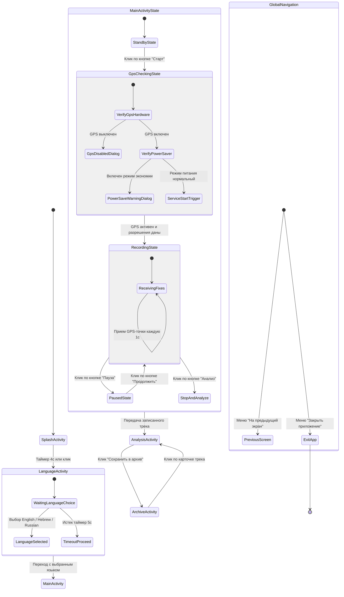

# 🧩 Диаграмма состояний, навигации и карта классов — Коэффициент извилистости

Руководство для учащихся: понимание состояний пользователя, переходов навигации и архитектуры системы.

---

## 1. Диаграмма 1: Состояния и навигация (Mermaid stateDiagram-v2)



### Как читать Диаграмму 1

| Элемент | Значение |
| :--- | :--- |
| `[*]` | Начальная или конечная точка жизненного цикла. |
| **Прямоугольник состояния (State)** | Экран или внутреннее состояние приложения, видимое пользователю. |
| **Составное состояние (Composite)** | Экран с внутренними подсостояниями (например, `MainActivityState`). |
| **Стрелка перехода** | Событие, клик или условие, переводящее из одного состояния в другое. |

---

## 2. Диаграмма 2: Карта классов и связей (Mermaid flowchart TD)

```mermaid
flowchart TD
  classDef activity fill:#DBEAFE,stroke:#1E40AF,stroke-width:3px
  classDef service fill:#E0E7FF,stroke:#3730A3,stroke-width:3px
  classDef dialog fill:#EDE9FE,stroke:#6D28D9,stroke-width:2px
  classDef model fill:#FEF9C3,stroke:#A16207,stroke-width:2px
  classDef data fill:#FCE7F3,stroke:#BE185D,stroke-width:2px
  classDef adapter fill:#FFEDD5,stroke:#C2410C,stroke-width:2px
  classDef helper fill:#F3F4F6,stroke:#6B7280,stroke-width:2px,stroke-dasharray:5 5
  classDef system fill:#E5E7EB,stroke:#9CA3AF,stroke-width:1px,stroke-dasharray:3 3

  subgraph UI["Слой: Экраны и представления"]
    SplashActivity["SplashActivity<br/>[Activity]"]
    LanguageActivity["LanguageActivity<br/>[Activity]"]
    MainActivity["MainActivity<br/>[Activity]"]
    AnalysisActivity["AnalysisActivity<br/>[Activity]"]
    ArchiveActivity["ArchiveActivity<br/>[Activity]"]
    TrackCanvasView["TrackCanvasView<br/>[View]"]
  end

  subgraph SERVICE["Слой: Фоновая служба"]
    TrackRecordingService["TrackRecordingService<br/>[Service]"]
  end

  subgraph MODEL["Слой: Модели"]
    Track["Track<br/>[Model]"]
    TrackPoint["TrackPoint<br/>[Model]"]
  end

  subgraph DATA["Слой: Хранение"]
    TrackStorage[("TrackStorage<br/>[Data]")]
  end

  subgraph HELPERS["Слой: Утилиты и адаптеры"]
    LocaleHelper[["LocaleHelper<br/>[Helper]"]]
    GpsCheckUtils[["GpsCheckUtils<br/>[Helper]"]]
    TrackAdapter[/"TrackAdapter<br/>[Adapter]"/]
  end

  subgraph LEGEND["Легенда"]
    L_Act["Activity<br/>[Activity]"]
    L_Svc["Service<br/>[Service]"]
    L_Mod["Model<br/>[Model]"]
    L_Dat[("Data<br/>[Data]")]
    L_Hlp[["Helper<br/>[Helper]"]]
    L_Adp[/"Adapter<br/>[Adapter]"/]
  end

  SplashActivity -->|Таймер 4с| LanguageActivity
  LanguageActivity -->|Таймер 5с или выбор| MainActivity
  MainActivity -->|Запуск / Привязка| TrackRecordingService
  MainActivity -.->|Использует холст| TrackCanvasView
  MainActivity -->|Передает трек| AnalysisActivity
  AnalysisActivity -.->|Использует холст| TrackCanvasView
  AnalysisActivity ==>|Сохраняет трек| TrackStorage
  ArchiveActivity ==>|Загружает/Удаляет| TrackStorage
  ArchiveActivity -.->|Использует список| TrackAdapter
  TrackRecordingService ==>|Обновляет точки| Track
  Track *-- TrackPoint
  LanguageActivity -.->|Применяет язык| LocaleHelper
  MainActivity -.->|Проверяет GPS| GpsCheckUtils

  class SplashActivity,LanguageActivity,MainActivity,AnalysisActivity,ArchiveActivity,L_Act activity
  class TrackRecordingService,L_Svc service
  class TrackCanvasView activity
  class Track,TrackPoint,L_Mod model
  class TrackStorage,L_Dat data
  class LocaleHelper,GpsCheckUtils,L_Hlp helper
  class TrackAdapter,L_Adp adapter
```

### Как читать Диаграмму 2

| Тип узла | Форма и цвет | Описание и пример из проекта |
| :--- | :--- | :--- |
| **Activity** | Синий прямоугольник `[ ]` | Экран пользователя (`MainActivity`, `SplashActivity`). |
| **Service** | Фиолетовый прямоугольник `[ ]` | Фоновая служба (`TrackRecordingService`). |
| **Model** | Желтый прямоугольник `[ ]` | Чистая модель данных (`Track`, `TrackPoint`). |
| **Data** | Розовый цилиндр `[( )]` | Слой сохранения данных в файл (`TrackStorage`). |
| **Adapter** | Оранжевый параллелограмм `[/ /]` | Адаптер списка `RecyclerView` (`TrackAdapter`). |
| **Helper** | Серый подпроцесс `[[ ]]` | Вспомогательная утилита (`LocaleHelper`, `GpsCheckUtils`). |

---

## 3. Объяснение простыми словами

### 1. Главная идея и аналогия
В любой миллисекундный момент времени приложение находится **ровно в одном состоянии**. Событие (клик, GPS-точка, завершение таймера) переводит его в следующее состояние. Понятие для продвинутых учащихся: **конечный автомат (Finite State Machine)**.

**Жизненная аналогия: Турникет в метро**
- **Состояние 1 (Заблокирован):** Ожидание проездного.
- **Событие (Приложена карта):** Проверка баланса.
- **Состояние 2 (Открыт):** Проход разрешен.
- **Событие (Человек прошел):** Возврат в Состояние 1.

---

## 4. Примеры кода

### Переход между экранами (Intent)
```java
Intent intent = new Intent(SplashActivity.this, LanguageActivity.class);
startActivity(intent);
finish();
```

### Сохранение данных (JSON)
```java
boolean saved = storage.addTrack(track);
if (saved) {
    Intent intent = new Intent(this, ArchiveActivity.class);
    startActivity(intent);
}
```

---

## 5. Вопросы для самопроверки

1. **Вопрос:** Какова длительность обратного отсчета на экране `LanguageActivity`?
   - *Ответ:* 5 секунд (5000 мс).
2. **Вопрос:** В какое состояние переходит главная активность при нажатии кнопки «Пауза» во время записи?
   - *Ответ:* `PausedState`.
3. **Вопрос:** Какой тип стрелки соединяет `AnalysisActivity` и `TrackStorage`?
   - *Ответ:* Утолщенная стрелка `==>`, обозначающая передачу данных на запись в JSON-файл.
