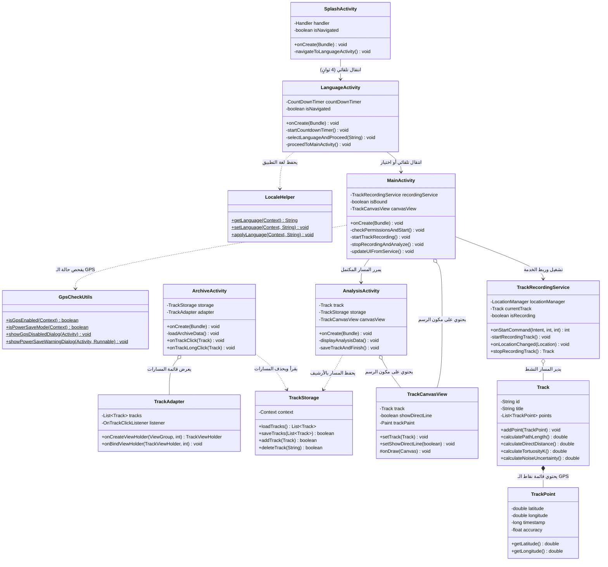

# 🧩 مخطط فئات UML ودليل تفصيلي — معامل التعرج

يوفر هذا المستند دليلاً سهلاً للطلاب والمطورين المبتدئين لفهم مخطط الفئات والعلاقات بين المكونات لمشروع **معامل التعرج (Tortuosity Coefficient)**.

---

## 1. مخطط الفئات (Mermaid classDiagram)

---

## 2. كيف تقرأ المخطط

| الرمز | المعنى |
| :--- | :--- |
| **مستطيل (Class)** | يمثل فئة واحدة. الاسم في الأعلى. |
| **`+` (Plus)** | عنصر عام (`public`) — متاح للفئات الأخرى. |
| **`-` (Minus)** | عنصر خاص (`private`) — متاح فقط داخل هذه الفئة. |
| **`$` (Dollar)** | عنصر ساكن (`static`) — يتم استدعاؤه مباشرة عبر اسم الفئة. |
| **`List~TrackPoint~`** | قائمة تحتوي حصريًا كائنات `TrackPoint`. |
| **سهم متصل `-->`** | انتقال بين الشاشات أو استدعاء مباشر. |
| **سهم منقط `..>`** | تبعية — الفئة تستخدم فئة أخرى بدون الاحتفاظ بها. |
| **معين فارغ `o--`** | تجميع — الفئة تحتوي كائنًا آخر يمكنه الوجود بشكل مستقل. |
| **معين ممتلئ `*--`** | تركيبة قوية — ملكية كاملة (مثل `Track` المحتوي على `TrackPoint`). |

---

## 3. أسئلة للاختبار الذاتي

1. **سؤال:** أي فئة ستعدلها إذا أردت تغيير معادلة حساب معامل التعرج $K$؟
   - *الجواب:* فئة `Track` (في الدالة `calculateTortuosityK`).
2. **سؤال:** ماذا يحدث إذا أزلنا السهم بين `MainActivity` و `TrackRecordingService`؟
   - *الجواب:* لن يتمكن التطبيق من بدء تسجيل الـ GPS في الخلفية ولن يتلقى التحديثات المباشرة.
3. **سؤال:** ما هي الفئة المسؤولة عن حفظ المسارات في ذاكرة الجهاز المحلية؟
   - *الجواب:* `TrackStorage` (تحفظ في ملف `saved_tracks.json`).
