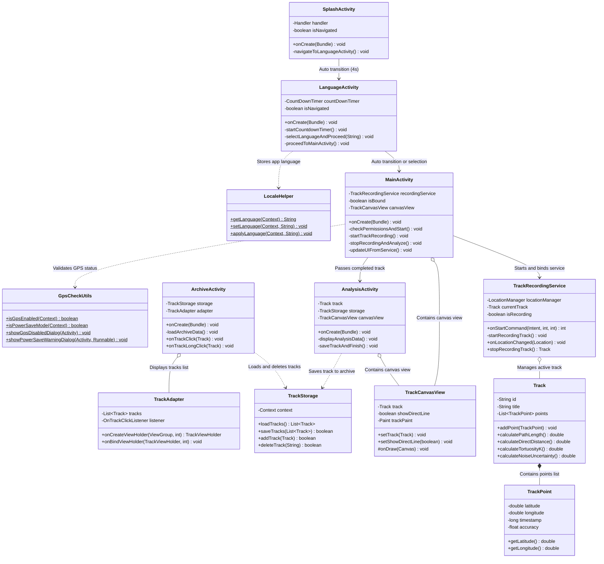

# 🧩 UML Class Diagram & Detailed Guide — Tortuosity Coefficient

This document provides a high-school-friendly guide to understanding class diagrams, component relationships, and UML reading rules for the **Tortuosity Coefficient** project.

---

## 1. Class Diagram (Mermaid classDiagram)

---

## 2. How to Read the Diagram

| Symbol | Meaning |
| :--- | :--- |
| **Rectangle (Class)** | Represents a single class. Name is at the top. |
| **`+` (Plus)** | Public member (`public`) — accessible from other classes. |
| **`-` (Minus)** | Private member (`private`) — accessible only inside this class. |
| **`$` (Dollar)** | Static member (`static`) — callable directly on class without instantiating. |
| **`List~TrackPoint~`** | Generics — list containing exclusively `TrackPoint` objects. |
| **Solid Arrow `-->` (Association)** | Navigation between screens or direct invocation. |
| **Dashed Arrow `..>` (Dependency)** | Dependency — class uses helper methods of another class. |
| **Empty Diamond `o--` (Aggregation)** | Aggregation — class contains another object that can exist independently. |
| **Filled Diamond `*--` (Composition)** | Composition — strong ownership (e.g. `Track` composed of `TrackPoint`s). |

---

## 3. Explanation in Simple Words

### 1. Main Idea
Every class in the project is responsible for a single defined role (Single Responsibility Principle). In a restaurant, the chef doesn't serve food and the waiter doesn't cook: similarly in the app, the screen presents UI, the service gathers GPS, and the model computes geometry.

### 2. Everyday Analogy: Public Transport Station
- **`SplashActivity` & `LanguageActivity`:** Entrance gate and information booth where language is chosen.
- **`MainActivity`:** Station manager displaying live flight board.
- **`TrackRecordingService`:** Bus driver running in background collecting stops (GPS points) continuously.
- **`TrackCanvasView`:** Map painter rendering route lines.
- **`TrackStorage`:** Ticket vault storing history safely in JSON.

---

## 4. Self-Test Questions

1. **Q:** Which class would you modify if you wanted to change the tortuosity calculation formula $K$?
   - *A:* The `Track` class (method `calculateTortuosityK`).
2. **Q:** What happens if we disconnect the arrow between `MainActivity` and `TrackRecordingService`?
   - *A:* The app won't be able to start background GPS recording or receive live updates.
3. **Q:** Why is the arrow between `LanguageActivity` and `LocaleHelper` dashed (`..>`) instead of solid (`-->`)?
   - *A:* Because `LanguageActivity` calls static methods of `LocaleHelper` without holding a permanent field instance.
4. **Q:** Which class handles saving tracks to local device storage?
   - *A:* `TrackStorage` (saves to `saved_tracks.json`).
