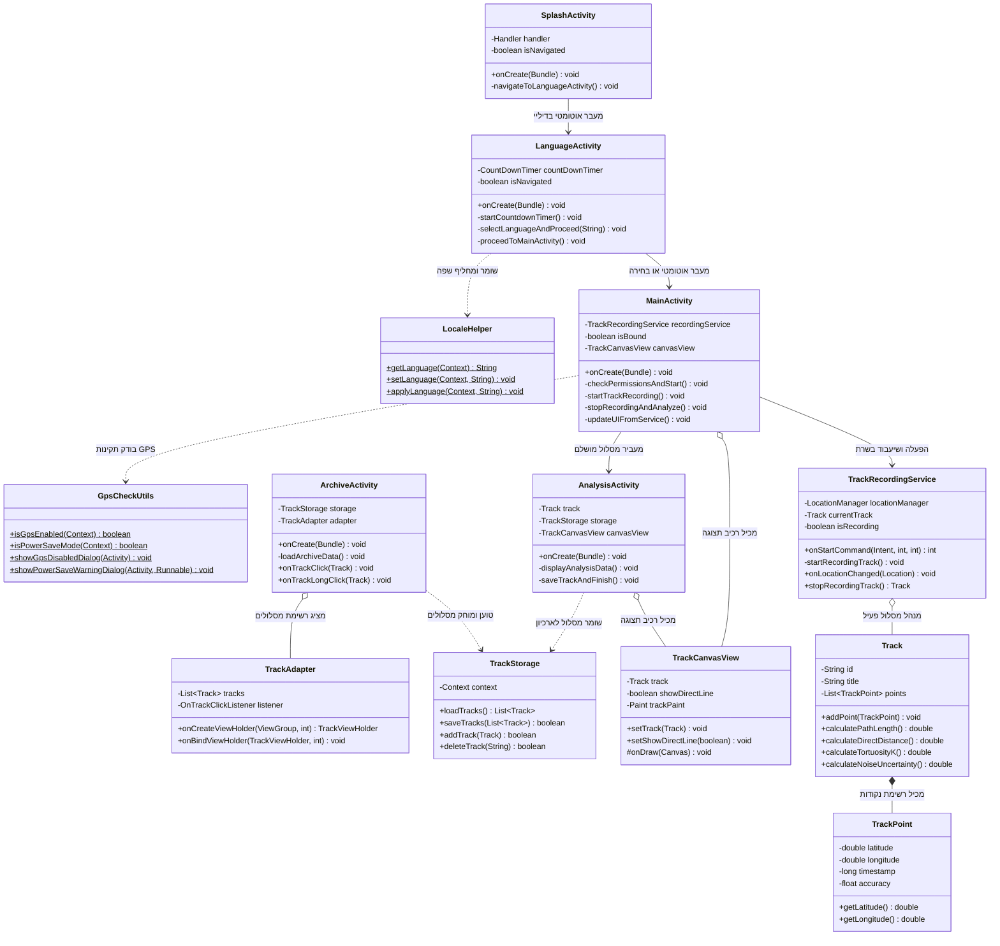

# 🧩 דיאגרמת מחלקות UML והסבר מפורט — מקדם פתלתלות

מסמך זה מיועד לתלמידי תיכון ולמפתחים מתחילים כדי להבין את מבנה המחלקות, הקשרים ביניהן והוראות הקריאה של דיאגרמת UML בפרויקט **"מקדם פתלתלות" (Tortuosity Coefficient)**.

---

## 1. דיאגרמת מחלקות (Mermaid classDiagram)



---

## 2. איך לקרוא את הדיאגרמה

| מה בדיאגרמה | מה זה אומר |
| :--- | :--- |
| **מלבן (Class)** | מייצג מחלקה אחת בפרויקט. השם מופיע בחלק העליון. |
| **הסימן `+` (Plus)** | משתנה או מתודה פומבית (`public`) — נגישה גם ממחלקות אחרות. |
| **הסימן `-` (Minus)** | משתנה או מתודה פרטית (`private`) — מוגנת ונגישה רק מתוך מחלקה זו. |
| **הסימן `$` (Dollar)** | מתודה סטטית (`static`) — ניתן לקרוא לה ישירות מתוך שם המחלקה ללא יצירת אובייקט. |
| **פורמט `List~TrackPoint~`** | ג'נריקס (Generics) — רשימה המכילה אך ורק אובייקטים מסוג `TrackPoint`. |
| **חץ מלא `-->` (Association)** | מעבר בין מסכים או הפעלה ישירה של רכיב אחד ע"י רכיב אחר. |
| **חץ מקווקו `..>` (Dependency)** | תלות — המחלקה משתמשת בשירותיו של קלאס אחר (למשל, קוראת למתודה סטטית). |
| **חץ מעוין ריק `o--` (Aggregation)** | אגרגציה — המחלקה מכילה אובייקט אחר כחלק ממנה, אך האובייקט המוכל יכול להתקיים בנפרד. |
| **חץ מעוין מלא `*--` (Composition)** | הרכבה חזקה — המחלקה מכילה אובייקטים המוצמדים אליה ישירות (למשל `Track` המורכב מ-`TrackPoint`). |

---

## 3. הסבר במילים פשוטות

### 1. הרעיון המרכזי
כל מחלקה בפרויקט אחראית על תפקיד מוגדר אחד בלבד (Single Responsibility Principle). במסעדה, השף לא מגיש את האוכל והמלצר לא מבשל: כך גם באפליקציה, המסך מציג נתונים, השירות אוסף GPS, והמודל מחשב את הגיאומטריה.

### 2. אנלוגיה יומיומית: תחנת תחבורה ציבורית
- **`SplashActivity` & `LanguageActivity`:** שער הכניסה והמודיעין שבו בוחרים את השפה.
- **`MainActivity`:** מנהל התחנה שמציג את הלוח בלייב.
- **`TrackRecordingService`:** נהג האוטובוס שנוסע ברקע ואוסף תחנות (נקודות GPS) ללא הפסקה.
- **`TrackCanvasView`:** צייר המפות שמשרטט את קו המסלול.
- **`TrackStorage`:** ארכיון הכרטיסים שמלמד אותנו כמה נסענו ושומר הכל בקופסה (JSON).

### 3. קבוצות המחלקות
1. **מסכים (Activities):** `SplashActivity`, `LanguageActivity`, `MainActivity`, `AnalysisActivity`, `ArchiveActivity`.
2. **איסוף ברקע:** `TrackRecordingService`.
3. **תצוגת גיאומטריה:** `TrackCanvasView`.
4. **מתמטיקה ונתונים:** `Track`, `TrackPoint`, `TrackStorage`.
5. **כלי עזר:** `GpsCheckUtils`, `LocaleHelper`, `TrackAdapter`.

### 4. איך לקרוא את החצים בדיאגרמה
- **`SplashActivity --> LanguageActivity`:** המסך הראשון עובר למסך בחירת השפה בתום 4 שניות.
- **`LanguageActivity --> MainActivity`:** מסך השפה מעביר למסך הראשי לאחר בחירת שפה או 5 שניות.
- **`MainActivity --> TrackRecordingService`:** המסך הראשי מפעיל ומשתעבד לשירות הרקע כדי לקבל עדכוני מיקום.
- **`MainActivity o-- TrackCanvasView`:** המסך הראשי מכיל בתוכו רכיב קנבס לשרטוט הדרך בלייב.
- **`MainActivity --> AnalysisActivity`:** בסיום ההקלטה המסך הראשי מעביר את המסלול המושלם למסך הניתוח.
- **`AnalysisActivity ..> TrackStorage`:** מסך הניתוח פונה לשריר השמירה כדי לשמור את המסלול בקובץ JSON.
- **`ArchiveActivity ..> TrackStorage`:** מסך הארכיון קורא מנהל האחסון כדי לטעון ולהציג את המסלולים.
- **`ArchiveActivity o-- TrackAdapter`:** מסך הארכיון מכיל מתאם להצגת הרשימה הנגללת.
- **`TrackRecordingService o-- Track`:** השירות מנהל אובייקט מסלול פעיל ואוסף לתוכו נקודות.
- **`Track *-- TrackPoint`:** המסלול מורכב מרשימה רציפה של נקודות GPS.
- **`MainActivity ..> GpsCheckUtils`:** המסך הראשי נעזר בעזר הבדיקות כדי לוודא שרכיב ה-GPS דלוק.
- **`LanguageActivity ..> LocaleHelper`:** מסך השפה נעזר ב-`LocaleHelper` כדי לשמור את השפה שנבחרה.

### 5. קשר לקוד Java (איך החצים נראים בקוד)

**דוגמה 1: חץ הרכבה (`*--`) בשדה המחלקה (`Track.java`)**
```java
public class Track implements Serializable {
    private List<TrackPoint> points; // Track מכיל רשימת TrackPoint
}
```

**דוגמה 2: חץ תלות (`..>`) בזימון מתודה סטטית (`LanguageActivity.java`)**
```java
// תלות ב-LocaleHelper ללא שמירת שדה קבוע
LocaleHelper.setLanguage(this, languageCode);
```

### 6. מה חשוב לזכור
- **הסתרה (Encapsulation):** משתנים מסומנים ב-`-` (`private`) כדי למנוע ממחלקות אחרות לשנות נתונים פנימיים ישירות.
- **הבדל בין תלות (`..>`) לבעלות (`o--` / `*--`):** תלות אומרת "אני קורא לפונקציה של הקלאס הזה", בעוד בעלות אומרת "יש לי שדה שמחזיק את האובייקט הזה".

---

## 4. שאלות לבדיקה עצמית

1. **שאלה:** באיזו מחלקה תעדכן את הקוד אם תרצה לשנות את נוסחת חישוב מקדם הפתלתלות $K$?
   - *תשובה:* במחלקת `Track` (במתודה `calculateTortuosityK`).
2. **שאלה:** מה יקרה אם ננתק את החץ בין `MainActivity` ל-`TrackRecordingService`?
   - *תשובה:* האפליקציה לא תוכל להפעיל את הקלטת ה-GPS ברקע ולא תקבל עדכוני מיקום.
3. **שאלה:** מדוע החץ בין `LanguageActivity` ל-`LocaleHelper` הוא מקווקו (`..>`) ולא מלא (`-->`)?
   - *תשובה:* מכיוון ש-`LanguageActivity` משתמשת במתודות הסטטיות של `LocaleHelper` ואינה מחזיקה אותו כאינסטנס קבוע.
4. **שאלה:** איזה קלאס אחראי על שמירת המסלולים בדיסק הקשיח של המכשיר?
   - *תשובה:* `TrackStorage` (שומר בקובץ `saved_tracks.json`).

---

## ❓ שאלות למורה (Notes)
- כל 13 המחלקות הקיימות בקוד הפרויקט מיוצגות ומסבירות באופן מלא בדיאגרמה.
- יחסי הג'נריקס יושמו בפורמט התואם ל-Mermaid (`List~TrackPoint~`).
