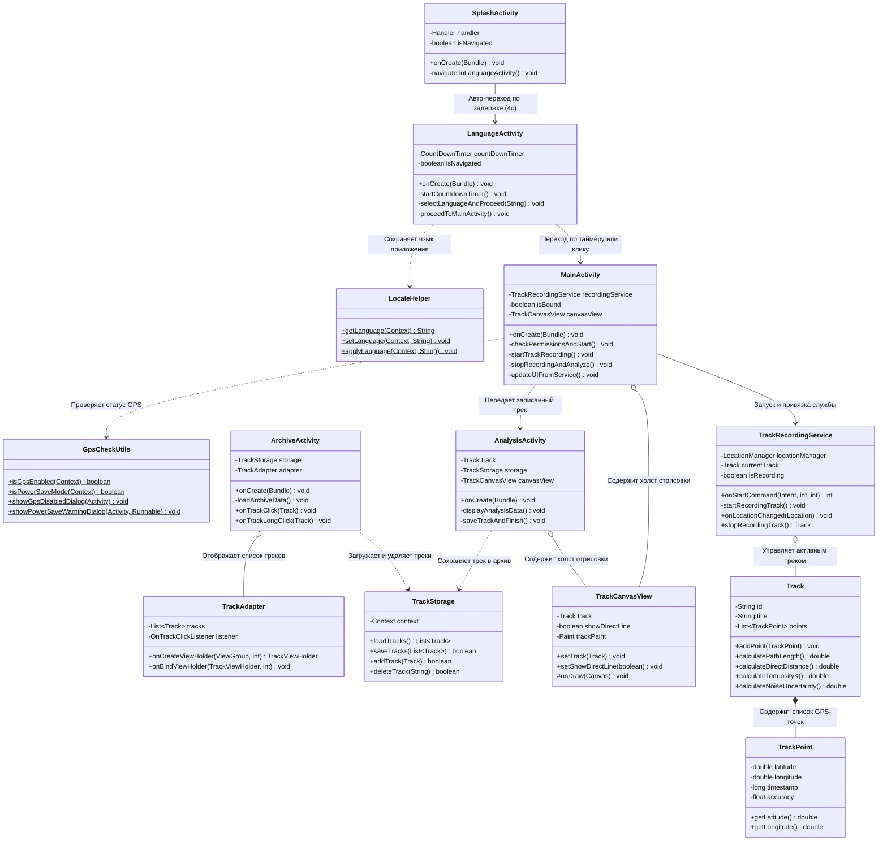

# 🧩 Диаграмма классов UML и подробное руководство — Коэффициент извилистости

Данный документ разработан для учащихся и начинающих разработчиков для понимания структуры классов, их взаимосвязей и правил чтения диаграмм UML в проекте **«Коэффициент извилистости» (Tortuosity Coefficient)**.

---

## 1. Диаграмма классов (Mermaid classDiagram)

---

## 2. Как читать диаграмму

| Обозначение | Значение |
| :--- | :--- |
| **Прямоугольник (Class)** | Означает один класс в проекте. Имя вверху. |
| **Знак `+` (Plus)** | Публичный элемент (`public`) — доступен из других классов. |
| **Знак `-` (Minus)** | Приватный элемент (`private`) — доступен только внутри этого класса. |
| **Знак `$` (Dollar)** | Статический элемент (`static`) — вызывается напрямую через имя класса. |
| **`List~TrackPoint~`** | Дженерики (Generics) — список объектов исключительно типа `TrackPoint`. |
| **Сплошная стрелка `-->`** | Ассоциация / Переход между экранами или прямой вызов. |
| **Пунктирная стрелка `..>`** | Зависимость — класс использует статические функции утилиты. |
| **Пустой ромб `o--`** | Агрегация — класс содержит объект, который может существовать отдельно. |
| **Закрашенный ромб `*--`** | Композиция — жесткое владение (например, `Track` состоит из `TrackPoint`). |

---

## 3. Объяснение простыми словами

### 1. Главная идея
Каждый класс отвечает только за одну свою задачу (Single Responsibility Principle). В ресторане шеф-повар не разносит еду, а официант не готовит: так и в приложении экран показывает UI, служба собирает GPS, а модель считает геометрию.

### 2. Жизненная аналогия: Общественная транспортная станция
- **`SplashActivity` & `LanguageActivity`:** Входные ворота и бюро информации, где выбирают язык.
- **`MainActivity`:** Диспетчер станции, показывающий табло рейсов в реальном времени.
- **`TrackRecordingService`:** Водитель автобуса, работающий в фоновом режиме и собирающий остановки (GPS-точки).
- **`TrackCanvasView`:** Художник карт, чертящий линию маршрута.
- **`TrackStorage`:** Сейф билетов, хранящий историю поездок в JSON.

---

## 4. Вопросы для самопроверки

1. **Вопрос:** В каком классе вы измените код, если потребуется поменять формулу расчета коэффициента извилистости $K$?
   - *Ответ:* В классе `Track` (в методе `calculateTortuosityK`).
2. **Вопрос:** Что произойдет, если убрать стрелку между `MainActivity` и `TrackRecordingService`?
   - *Ответ:* Приложение не сможет запустить фоновую запись GPS и не получит обновления координат.
3. **Вопрос:** Почему стрелка между `LanguageActivity` и `LocaleHelper` пунктирная (`..>`), а не сплошная (`-->`)?
   - *Ответ:* Потому что `LanguageActivity` вызываeт статические методы `LocaleHelper` и не хранит его постоянное поле.
4. **Вопрос:** Какой класс отвечает за сохранение маршрутов в память устройства?
   - *Ответ:* `TrackStorage` (сохраняет в файл `saved_tracks.json`).
